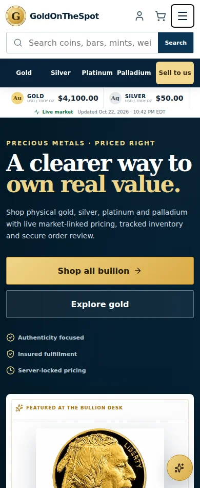
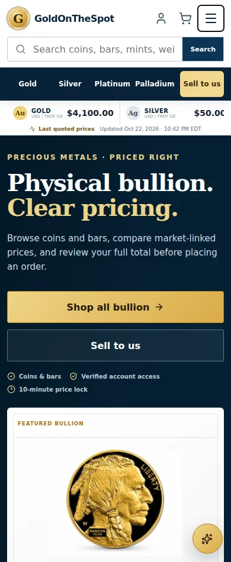
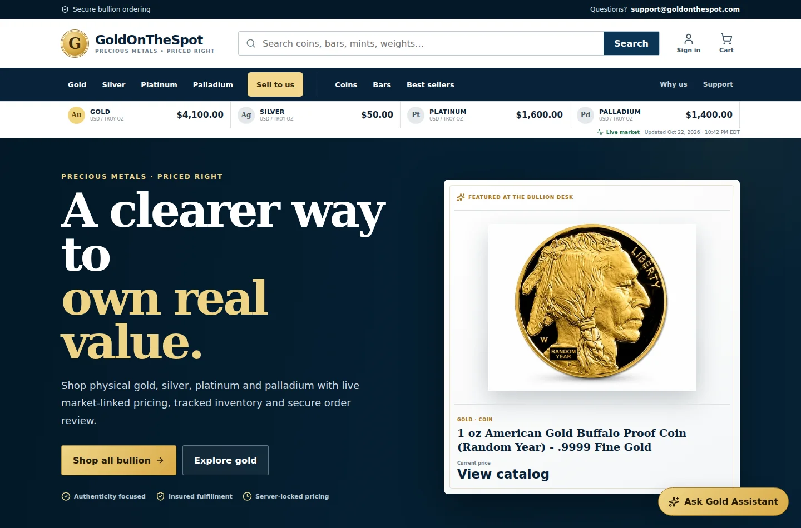
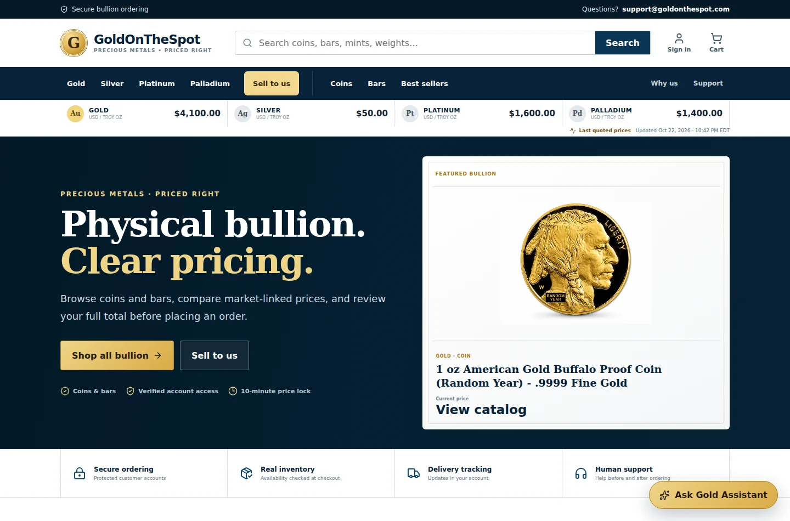

# Gold On The Spot — pre-launch audit, 23 October 2026

**Recommendation: NO-GO for a general launch or unrestricted high-value trading.** The verified fixes below improve the current application. They do not close the tax, native Auth recovery, payment acceptance, inventory, insurance, and recovery gates. No real financial transaction was performed. No production customer data was deleted.

## Scope and architecture

Inspected the existing React/Vite storefront, Vercel API handlers, Supabase Auth/Edge Functions/Postgres/RLS/storage, Stripe integration, catalog, pricing, account, support, selling, and administrative flows. This is not a Next.js application. Existing architecture, compact navigation, gold/navy branding, hero coin, payment methods and checkout behavior were preserved. This is a source/configuration review plus automated/fixture testing and selected production probes, not an independent penetration-test certification or proof that every possible bug is absent.

## Findings and disposition

| Severity | Finding | Disposition / evidence |
| --- | --- | --- |
| Critical | Active Silver Maple SKU `SML-1OZ-BU-RY` had a **-99% dynamic premium**, permitting an extreme below-spot quote. | **Contained in production:** product 18 disabled, reason recorded in `admin_audit_log`. Premium retained for investigation; no guessed replacement. Existing orders untouched. Checkout's existing database function rechecks product activity. Owner must confirm intended pricing before reactivation. One historical item observed at $59.41/unit; this inspection did not establish a historical pricing loss. |
| High | Checkout has no implemented sales-tax engine. | **Open launch blocker.** Owner/accountant must provide registrations, supported destinations and product-specific treatment; implement and acceptance-test before taking affected orders. No invented exemptions or tax rates. |
| High | Custom SMS recovery does not enforce SMS at every native Supabase Auth password-update path. | **Open launch blocker.** Existing custom reset grant is one-time and SMS-bound, but it does not close direct Auth recovery/update. Requires supported Auth-level MFA design and tested enrollment/migration. No security check was disabled; no paid plan was purchased. |
| High | Full provider acceptance testing is unavailable without an isolated database and Stripe sandbox. Manual capture is configured off. | **Open launch blocker.** Test card success, decline, 3DS, expiry during 3DS, lost response, duplicate webhooks, refunds and cancellations. Existing automatic-capture late-settlement risk remains. No live charges/refunds were used as tests. |
| High | Backup retention, isolated restore and external alert delivery are not demonstrated. | **Open launch blocker.** Existing operations dashboard and reconciliation are useful but are not a tested recovery plan or external paging. Confirm current plan, protected storage backups and credentials, recovery targets, isolated restore results and alert destination. |
| Medium | Public metal-price caching allowed a full day of stale responses, and old timestamps could be presented as live. | **Fixed:** bounded cache windows in both API and Vercel configuration, provider/client timeouts, oldest component timestamp, explicit missing/stale/error states, no fabricated update time. Server quote calculations remain authoritative. |
| Medium | Homepage catalog-fetch failure was liable to appear as an empty catalog. | **Fixed:** visible failure and retry; retained cached products remain useful. |
| Medium | Selling cases lacked private ongoing correspondence and photographs. | **Implemented:** separate customer/admin conversation, owner-bound API, private photos, temporary links, upload/message limits, audited admin replies, request deduplication and retained retry drafts. Browser and database/handler tests passed; live authenticated owner acceptance remains required. |
| Medium | Gold Eagle description incorrectly called the newer gold reverse “Eagle Landing,” confusing it with the Silver Eagle. Gross weight versus actual gold content needed clarity. | **Corrected in production**, audited: eagle-head reverse introduced in 2021; 1 troy oz actual gold, approximately 33.931 g gross, 22-karat alloy. Random-year listing can contain either reverse. |
| Medium | Catalog photography, packaging and grade/security-feature claims cannot be established from the database. Some image filenames indicate generated artwork; that alone is not proof of accuracy. | **Open business check:** compare all six SKUs against physical stock and licensed images. Verify Buffalo Proof packaging/finish, Maple .9999 stock years, and PAMP assay/VERISCAN packaging. Do not list earlier .999 Gold Maples under a .9999 SKU. No invented substitute images were used. |
| Medium | Company credibility depends on actual insurance, contact/address details, wire beneficiary verification, fulfillment capability and legally reviewed terms. | **Open business/legal gate.** Removed prominent unconditional homepage insurance/signature claims, retained clear purchasing information. Existing policies and versioned order agreements are not legally approved merely because they are published. |
| Medium | Supabase advisor reports leaked-password protection disabled. | **Open:** select a supported protection approach compatible with the owner's plan; no paid option activated silently. |
| Low | Advisor warns about managed `pg_net` in `public`; private service-only tables have RLS-without-policy notices. | No destructive extension move. Service-only tables intentionally deny client access. Have platform-supported remediation reviewed separately. |
| Low/Medium | Large product assets (including multi-megabyte PNGs) and no measured field Core Web Vitals. | All 14 active image URLs returned image responses and decoded. Existing optimized local hero retained. Asset optimization and real-device/field performance measurement remain; no invented performance score. |
| Low | Oversized hero spacing, decorative treatments and generic copy diluted the storefront. | Refined existing hero spacing, typography and copy; reduced decorative shadow/glow; retained compact ticker/date and visible Sell to us navigation. Added reduced-motion handling and stable numeric price widths. |
| Low | Temporary private photo links expire; uncertain write responses can leave unattached uploaded objects. | UI offers refresh and keeps retry drafts. Uploads are bounded/private; preserve uncertain uploads for reconciliation rather than deleting a possibly committed attachment. Scheduled orphan reconciliation and more than 200 messages per case are future operational work. |

## Catalog review

Six unique listed SKUs were inspected; five remain active after the pricing quarantine. All current active products are gold. Silver/platinum/palladium navigation does not imply current stock. No products or metal inventory were invented.

- Buffalo Proof: existing listing states 1 troy oz .9999 gold, $50 face value; physical proof condition, capsule and any box/COA must be confirmed by the business.
- American Gold Eagle: corrected reverse text and fine-versus-gross weight above. Product page already labels the numeric field “Pure metal weight.”
- PAMP Lady Fortuna: existing 1 oz .9999/assay description retained; actual assay/VERISCAN variant needs stock confirmation.
- APMEX TEP: existing 1 oz .9999/TEP specification consistent with manufacturer's product page; verify exact supplied packaging and image rights.
- Gold Maple random year: .9999 stock selection must exclude earlier .999 issues. Portrait/design varies by year.
- Silver Maple: .9999/1 oz listing retained but inactive pending correct premium. No availability promise.

Primary references inspected: US Mint bullion program and 2020 announcement of the 2021 reverse designs; US Mint Buffalo program; Royal Canadian Mint Silver Maple information; APMEX's own product 60162. Manufacturer specifications do not prove the seller's inventory.

- https://www.usmint.gov/coins-precious-metal-coins/bullion-coin-programs/
- https://www.usmint.gov/news/press-releases/united-states-mint-unveils-new-american-eagle-gold-and-silver-coin-reverse-designs
- https://www.apmex.com/product/60162/1-oz-gold-bar-apmex-tep

## Changes and affected files

| Files / data | Changes |
| --- | --- |
| `api/metals.js`, `vercel.json` | GET-only quote endpoint, bounded cache, provider timeouts, conservative timestamp, generic error response. |
| `src/lib/marketPrices.js`, `src/lib/marketStatus.js`, `src/components/MarketTicker.jsx`, `src/styles/marketTimestamp.css` | Client timeout, freshness classification, actual Eastern date/12-hour time, tabular prices and compact status treatment. |
| `src/pages/HomePage.jsx`, `src/styles/storefrontPolish.css` | Existing hero refinement, clear buy/sell actions, catalog error/retry, qualified trust copy, reduced motion. |
| `src/pages/SellPage.jsx`, `src/components/SellingCases.jsx`, `src/components/admin/SellAdminPanel.jsx` | Selling-case copy, lazy case conversation and separate admin correspondence. |
| `src/components/SellingConversation.jsx`, `src/styles/sellingConversation.css` | Per-case drafts, retry IDs, pagination, loading/errors, photos, private-link refresh, responsive thread. |
| `supabase/functions/sell-case-thread/index.ts` | Verified session/role/ownership, strict payloads, bounded uploads, private storage access, safe errors and rate limits. |
| `supabase/migrations/20261023044029_selling_case_conversations.sql` | Private conversation table, service-only atomic append RPC, audit records and private photo bucket. Applied in production. |
| `scripts/check-market-status.mjs`, `scripts/check-selling-conversation.mjs`, `package.json` | Eight new automated tests included in the regular checks. |
| Production `products` / `admin_audit_log` | Quarantined product 18 and corrected product 14 description, each with an audit entry. No orders/prices already recorded on orders changed. |
| `docs/prelaunch-2026-10-23/` and this report | Browser evidence, dependency/asset checks and before/after captures. |

## New database and authentication protections

`public.sell_case_messages` has RLS enabled and no anonymous/authenticated table privileges. The append RPC is callable only by the service role. It verifies case owner or actual administrator membership, serializes writes with a case-row lock, derives sender role server-side, prevents changed-payload replay, and atomically records admin reply metadata without message contents. Existing support tickets remain separate.

The Edge function verifies the bearer token with Auth, checks the live session, requires customer SMS verification or administrator AAL2, and filters the case by owner before accessing messages. Request-supplied actor/role/status fields are rejected. This supplements, and does not replace, the existing account/admin protections. Gateway JWT verification is disabled for compatibility with the existing key setup; **the function itself performs token and session verification before every protected operation**.

The photo bucket is private, limited to 1 MB JPEG/PNG/WebP objects. The API checks base64 size and file signatures, creates server-selected paths, and returns five-minute signed URLs only after authorization. The browser decodes/resizes photos and strips camera metadata by re-encoding. No SVG/HTML uploads. File-signature validation is not malware scanning or proof of image authenticity. Direct client storage permissions were not granted.

New persistent per-user limits: conversation reads **120/10 minutes**, sends **30/hour**, photo uploads **12/hour**; database caps **6 photos and 200 messages per case**. Existing OTP/checkout/payment/admin rate limits remain unchanged.

Production checks confirmed RLS enabled, anonymous read denied, authenticated insert/RPC denied, private bucket with 1 MB limit, and unauthenticated Edge request **401**. Cross-owner, invalid session and non-MFA-admin tests ran against the handler/database harness, not real customer identities.

## Checkout, payment and admin review

No payment architecture was replaced in this release. Existing automated checks exercise server-derived totals, strict amount/quantity schemas, quote ownership/expiry, payment maximums, shipping thresholds, inventory, one-time OTPs, ownership restrictions, admin MFA, valid order transitions, wire consent, canonical Stripe amount/currency/identity matching, webhook signatures/idempotency, refund state, reconciliation leases, risk approval and audit rollback.

Passing these tests does **not** prove Stripe sandbox or production settlement. Card manual capture remains disabled. Crypto/check journeys were not certified: checks are not an implemented checkout method, and disabled methods must not be advertised as available. Production shipping remains $35 unless product/store overrides apply. No testing-only free-shipping override was introduced.

Admin browser fixtures verify tracking-only saves, visible server rejection, retry, cancellation and shipping after paid/risk-approved state. Risk approval does not mark an unpaid order paid. Support drafts survive case switching and error recovery. No real customer's payment, fulfillment, refund or risk state was modified for testing.

## Executed validation

| Test | Actual result / boundary |
| --- | --- |
| `npm run check` | **PASS:** search checks, 9 signup + 126 security/API/database + 36 email + 30 support/selling/market tests = **201**; production build passed. |
| Final build after homepage copy refinement | **PASS.** |
| `npm audit --omit=dev --json` | **0 reported production vulnerabilities** at execution. This is known-advisory coverage, not a guarantee of dependency safety. No unnecessary upgrades. |
| Client source + built assets secret-pattern scan | No Stripe secret, Supabase secret-key or private-key pattern found. Public publishable key is intentional. Not a full-history forensic secret audit. |
| Header/privacy browser fixture | PASS at 1440, 1280, 1100, 1050, 1024, 768, 390, 320 px: navigation, mobile menu/Escape, active category, date/AM-PM/timezone, archived terms, analytics opt-out/GPC, no document overflow or uncaught page errors. |
| Catalog journey replaying live public catalog | PASS all 5 active product pages, images, excessive-quantity block, add-to-cart for each, cart reload persistence, simulated out-of-stock disable. No customer/payment writes. |
| Image checks | 14/14 active image URLs returned successfully and decoded; contact sheet visually inspected. Correct physical product/grade and image licensing are separate business checks. |
| Selling customer browser fixture | PASS login redirect, create failure/retry with same ID, receipt focus, case reload, JPEG preparation/upload payload, conversation reload; widths 1440/1024/768/390/320; no page errors. |
| Selling admin browser fixture | PASS per-case drafts, conflict recovery, status filters/search, reply retry ID, mobile inbox/detail, start review; same five widths; no page errors. |
| Account browser fixture | PASS profile, navigation and reset checks. Does not deliver real OTPs. |
| Wire checkout browser fixture | PASS explicit consent, server error and retained form, instruction presentation, verified-phone preservation, mobile/desktop; no production order. |
| Admin order browser fixture | PASS tracking, failed save/retry, cancellation, paid/approved shipping and mobile save. An obsolete test selector initially failed; updated it to the existing “Manage order” label and reran successfully. |
| Storefront/support/bank browser fixture | PASS catalog/product failure recovery, image fallback/gallery, empty states, mobile query navigation, support drafts, bank HTTP/network/malformed failures, retry, save protection, sensitive-field clearing and mobile fit. |
| Production database/Edge probes | Private table/RPC/bucket permissions confirmed; anonymous conversation request denied 401. No authenticated production conversation was sent. |
| Real card/crypto/check settlement; live OTP/inbox delivery; full restore; field CWV | **NOT EXECUTED / NOT CERTIFIED.** Requires the isolated environments, owner-controlled identity and business decisions below. |

Browser tests used Chromium and controlled fixtures/replayed public reads. They are not Safari/iOS/Android physical-device tests or a keyboard-overlay accessibility audit. A complete real customer journey remains a launch gate. No performance score or blanket “all bugs fixed” claim is made.

## Before and after

Matched header/hero captures use the same synthetic catalog/price fixture and viewport against the prior commit and updated code. The date is deliberately old to demonstrate the corrected stale-price label. They illustrate layout changes, not actual market prices. Selling screenshots contain fictitious identities and fixture messages.

| View | Before | After |
| --- | --- | --- |
| Mobile header/hero |  |  |
| Desktop header/hero |  |  |

[Customer selling conversation](prelaunch-2026-10-23/selling-customer-after-320.webp) · [Admin selling workspace](prelaunch-2026-10-23/selling-admin-after-390.webp)

## Required owner/business/legal actions

1. Confirm the Silver Maple premium, actual inventory/grade/packaging, image rights, best-seller/authenticity claims and maximum order exposures before restoring the listing.
2. Complete tax implementation with an accountant's jurisdiction/product rules; registration alone does not calculate tax.
3. Approve a supported Auth-level MFA/recovery solution compatible with the desired costs, and test existing-user migration.
4. Provide isolated database + Stripe sandbox configuration in server secrets. Complete real sandbox card/3DS/failure/expiry/refund/webhook tests before enabling manual capture or declaring payments launch-ready.
5. Use an owner-controlled email and phone for real signup/resume, verification, login/reset, support and order-notification delivery/bounce tests. Do not share OTPs or credentials in chat.
6. Confirm company mailing/contact information, bank beneficiary/routing details, precious-metal insurance limits, signature/destination rules, fulfillment capability and retention/deletion procedures. Have counsel review purchase/wire cancellation obligations, market-loss terms, sale/assay/melting consent, privacy and terms.
7. Establish protected database/storage backups, perform an isolated restore with outbound jobs disabled, configure external alerts and verify delivery.
8. Complete physical mobile-device/browser and accessibility acceptance, and measure production performance under realistic connections.

## Rollback and operational handling

Previous known-ready production deployment: `dpl_ETkweztMHhPVF8SFwfnF3xLdegX7`, main commit `9bcbe2e965720a73cdf18a329a96ea60850d5d3f`. Roll back the application deployment if necessary. The new database migration is additive: retain private messages/photos and audit history; do not drop customer data to roll back UI. The old UI can run without using the new conversation endpoint. Disable that endpoint if its behavior is suspect, preserving records for reconciliation.

Keep Silver Maple inactive during rollback; the bad premium must not return to sale. Do not undo the corrected Gold Eagle specification. Do not replay financial events or change payment state based on browser redirects. Reconcile canonical provider records before fulfillment.

Deployment verification is recorded separately after the release reaches READY. This report remains **NO-GO** until the open gates have actual evidence of completion.
